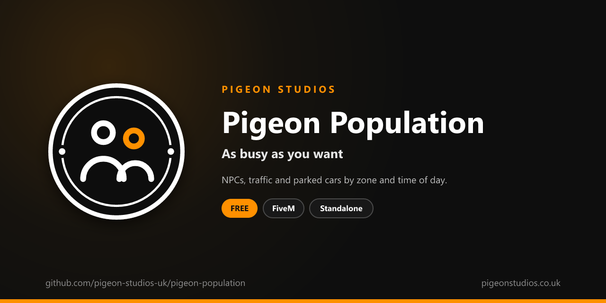

<div align="center">
  

  <h1>Pigeon Population</h1>

  <p><strong>Sets how many NPCs, cars and parked vehicles GTA spawns, by zone and time of day, plus garbage trucks, boats and distant traffic.</strong></p>

  <p>
    <a href="https://github.com/pigeon-studios-uk/pigeon-population/releases/latest"></a>
    <a href="LICENSE.md"></a>
    <a href="https://discord.gg/2NFVWEUmDF"></a>
    
  </p>

  <p>
    <a href="https://github.com/pigeon-studios-uk/pigeon-population/releases/latest"><strong>Download</strong></a> ·
    <a href="#installation">Install</a> ·
    <a href="#configuration">Configure</a> ·
    <a href="CHANGELOG.md">Changelog</a> ·
    <a href="https://discord.gg/2NFVWEUmDF">Support</a>
  </p>
</div>

---

## Contents

- [Overview](#overview)
- [Features](#features)
- [Requirements](#requirements)
- [Installation](#installation)
- [Updating](#updating)
- [Configuration](#configuration)
- [Commands and exports](#commands-and-exports)
- [How it works](#how-it-works)
- [Update checker](#update-checker)
- [Performance](#performance)
- [Security](#security)
- [Troubleshooting](#troubleshooting)
- [FAQ](#faq)
- [Support](#support)
- [Contributing](#contributing)
- [Licence](#licence)
- [Credits](#credits)

## Overview

Pigeon Population is a free resource by [Pigeon Studios](https://pigeonstudios.co.uk) that controls how busy GTA's world is. GTA fills the streets with NPCs, traffic and parked cars at the same level everywhere, all day. On roleplay servers that's often too much: traffic gets in the way of pursuits, crowds hurt performance, and the city feels the same at 3am as at noon.

With this resource you set each kind of population on its own, from none to GTA's normal amount, and change it by time of day and by area. Make the city quiet at night, empty Fort Zancudo, or keep the airport busy.

## Features

- **Six values.** Walking NPCs, NPCs in scenarios (inside and outside), traffic, random vehicles and parked cars, each from 0.0 (none) to 1.0 (GTA's normal).
- **By time of day.** Periods by in-game hour, including ones that run past midnight.
- **By zone.** Different numbers for any of GTA's zones, such as the airport, downtown or Sandy Shores.
- **Only what you list.** A time or zone only changes the values it gives, and the rest come from the default.
- **Other traffic.** Garbage trucks, NPC boats and the distant traffic GTA draws far away, each on or off.
- **Export.** Other resources can change the numbers for an event, such as emptying the streets for a race.
- **Standalone.** No framework or other resources needed.

## Requirements

| Requirement | Version | Notes |
|---|---|---|
| FXServer | A [recommended artifact](https://runtime.fivem.net/artifacts/) | |

**Frameworks:** none needed. It works the same on standalone servers, ESX Legacy, QBCore, Qbox and ox_core.

## Installation

1. **Download** `pigeon-population.zip` from the [latest release](https://github.com/pigeon-studios-uk/pigeon-population/releases/latest). Don't use the green **Code** button; release zips are the tested builds.
2. **Extract** it into your server's `resources` folder. The folder must be called `pigeon-population`.
3. **Start it** by adding this to `server.cfg`:

   ```cfg
   ensure pigeon-population
   ```

4. **Configure** it in `configuration/config.lua` if you want to change anything. Out of the box it keeps GTA's normal numbers in the day and makes the streets quieter between midnight and 6am.
5. **Restart** your server. The console shows one line from the update checker:

   ```text
   [Pigeon Studios] Pigeon Population v1.0.0 is up to date.
   ```

## Updating

1. Read the [changelog](CHANGELOG.md) for every version between yours and the latest, especially any **Upgrade notes**.
2. Back up your `configuration/` folder.
3. Replace the `pigeon-population` folder with the new release.
4. Copy your changed settings into the new `configuration/config.lua`. Don't copy the old file over the new one; new versions can add settings.
5. Restart the resource.

## Configuration

All settings are in `configuration/config.lua`, each explained by a comment next to it.

| Setting | Default | What it does |
|---|---|---|
| `Config.Default` | all `1.0` | The values everywhere, at every time of day |
| `Config.Times` | midnight to 6am at `0.4` | Periods by in-game hour, each changing the values it lists |
| `Config.Zones` | none | Values by GTA zone, which win over `Config.Times` |
| `Config.GarbageTrucks` | `true` | Garbage trucks on their rounds. `nil` leaves it to GTA |
| `Config.RandomBoats` | `true` | NPC boats. `nil` leaves it to GTA |
| `Config.DistantTraffic` | `true` | The far-off traffic GTA draws in the distance. `nil` leaves it to GTA |

The values in `Config.Default`, each from `0.0` (none) to `1.0` (GTA's normal amount, and the most GTA allows):

| Value | What it sets |
|---|---|
| `peds` | NPCs walking around |
| `scenarioPedsInside` | NPCs doing something in one place, such as sitting or working, inside buildings |
| `scenarioPedsOutside` | The same, outside |
| `traffic` | NPC vehicles driving around |
| `randomVehicles` | Extra random vehicles GTA adds to the traffic |
| `parkedVehicles` | Vehicles parked at the roadside and in car parks |

A quiet night and an empty military base:

```lua
Config.Times = {
    { from = 22, to = 6, peds = 0.3, traffic = 0.3, randomVehicles = 0.3 },
}

Config.Zones = {
    ARMYB = { peds = 0.0, scenarioPedsOutside = 0.0, traffic = 0.0, parkedVehicles = 0.0 },
}
```

Zone names are GTA's short codes, listed in the [FiveM zones reference](https://docs.fivem.net/docs/game-references/zones/).

## Commands and exports

Client exports, for other resources:

```lua
-- Set values on top of the config for this player, such as during an event. Only the values given
-- change. Takes effect within a second.
exports['pigeon-population']:SetDensity({ peds = 0.0, traffic = 0.0, parkedVehicles = 0.0 })

-- Back to the config.
exports['pigeon-population']:SetDensity(nil)

-- The values in use right now, such as { peds = 1.0, traffic = 0.4, ... }.
local values = exports['pigeon-population']:GetDensity()
```

The export runs in one player's game, so call it for every player who should see the change: for example from a client event your server sends to everyone.

## How it works

Once a second, the resource looks at the player's GTA zone and the in-game hour, and works out the six values: first `Config.Default`, then any `Config.Times` period that matches the hour, then the player's entry in `Config.Zones`, then anything set with the `SetDensity` export. Each step only changes the values it lists.

GTA's density natives only last one frame, so the resource sets those values every frame. GTA decides population in each player's own game, for the area around them, so every player runs it, which FiveM does automatically for client scripts. Garbage trucks, boats and distant traffic are switched once a second, and put back to GTA's defaults when the resource stops.

Density only changes what GTA spawns from now on. NPCs and vehicles already there stay until GTA removes them, so a change takes a few seconds to show.

## Update checker

When it starts, Pigeon Population checks our public [version registry](https://github.com/pigeon-studios-uk/pigeon-versions) once and prints one line in the server console saying whether it's up to date. If there's an update, it shows what's new and where to get it. The check is a single request to GitHub and sends nothing about your server or players.

Control it for every Pigeon Studios resource at once in `server.cfg`:

```cfg
set pigeon_update_check "on"      # default: one line per resource
set pigeon_update_check "quiet"   # only when there's an update or a problem
set pigeon_update_check "off"     # never check
```

## Performance

It works out the values once a second, and sets five density values every frame, which GTA needs and which costs almost nothing. Fewer NPCs and vehicles usually make the game run faster. Nothing runs on the server apart from the update check at start-up.

## Security

- It runs only in each player's own game and only changes what GTA spawns around that player.
- It has two client exports for other resources on your server, and no commands or network events, so there is nothing other players or the server can send it.
- The only network request is the update check at start-up, from the server to GitHub. It sends nothing about your server or players.
- It's a world setting, not a rule. A player with a modified game could see more or fewer NPCs, but it can't change what other players see.

Found a problem? Please don't open a public issue. Use the **Report a vulnerability** button in this repository's **Security** tab, or follow our [Security Policy](https://github.com/pigeon-studios-uk/.github/blob/main/SECURITY.md).

## Troubleshooting

**Nothing seems to change.**
NPCs and vehicles already around stay until GTA removes them, so give it a few seconds, or drive somewhere new. Check the resource is started and there are no errors in the F8 console. Another resource that sets density every frame will fight with this one; only run one.

**There's still traffic with `traffic = 0.0`.**
Set `randomVehicles` and `parkedVehicles` to `0.0` as well. Vehicles spawned by other resources, such as jobs or garages, aren't GTA's population and aren't affected.

**A zone doesn't work.**
Zone names must be GTA's short codes in capitals, such as `AIRP` or `SANDY`. Check them in the [FiveM zones reference](https://docs.fivem.net/docs/game-references/zones/).

**The console says "isn't in the version registry" or "couldn't check for updates".**
Your server couldn't reach GitHub, or the check is blocked by a firewall. The resource works normally either way. Turn the check off with `set pigeon_update_check "off"`.

## FAQ

**Is it really free?**
Yes. Use it on as many servers as you like, including ones that take donations. You just can't reupload, resell or bundle it. See [Licence](#licence).

**Can I go above GTA's normal amount?**
No. GTA won't spawn more than its normal amount, so values above `1.0` are treated as `1.0`.

**Does it work in routing buckets?**
Yes. For a bucket with no population at all, FiveM's own `SetRoutingBucketPopulationEnabled` on the server is simpler.

**Can I turn off AI police too?**
That's [Pigeon No Wanted](https://github.com/pigeon-studios-uk/pigeon-no-wanted).

## Support

Read [Troubleshooting](#troubleshooting) first, then ask in the support channels of our [Discord](https://discord.gg/2NFVWEUmDF). Please include your Pigeon Population version, FXServer artifact and any errors from the console. See [Getting help](https://github.com/pigeon-studios-uk/.github/blob/main/SUPPORT.md).

Found a bug? Open a [bug report](https://github.com/pigeon-studios-uk/pigeon-population/issues/new/choose).

## Contributing

Fixes, improvements and translations are welcome. Please read the [contributing guide](https://github.com/pigeon-studios-uk/.github/blob/main/CONTRIBUTING.md) first, and open a feature request before working on anything big.

## Licence

Pigeon Population is free to use under the **[Pigeon Studios Free Licence](LICENSE.md)**.

- ✅ Use it on any number of servers, including monetised ones
- ✅ Change it for your own servers
- ✅ Show it in videos and streams
- ❌ Don't reupload, share or mirror the files; link to this repository instead
- ❌ Don't sell it, bundle it in packs, or put it behind escrow
- ❌ Don't remove the credits

This summary isn't the licence; [LICENSE.md](LICENSE.md) is. Third-party notices are in [NOTICE.md](NOTICE.md).

## Credits

Made by [Pigeon Studios](https://pigeonstudios.co.uk).

<sub>Not affiliated with or endorsed by Rockstar Games, Take-Two Interactive or Cfx.re.</sub>
